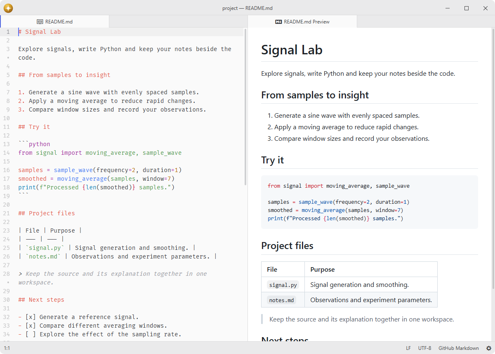
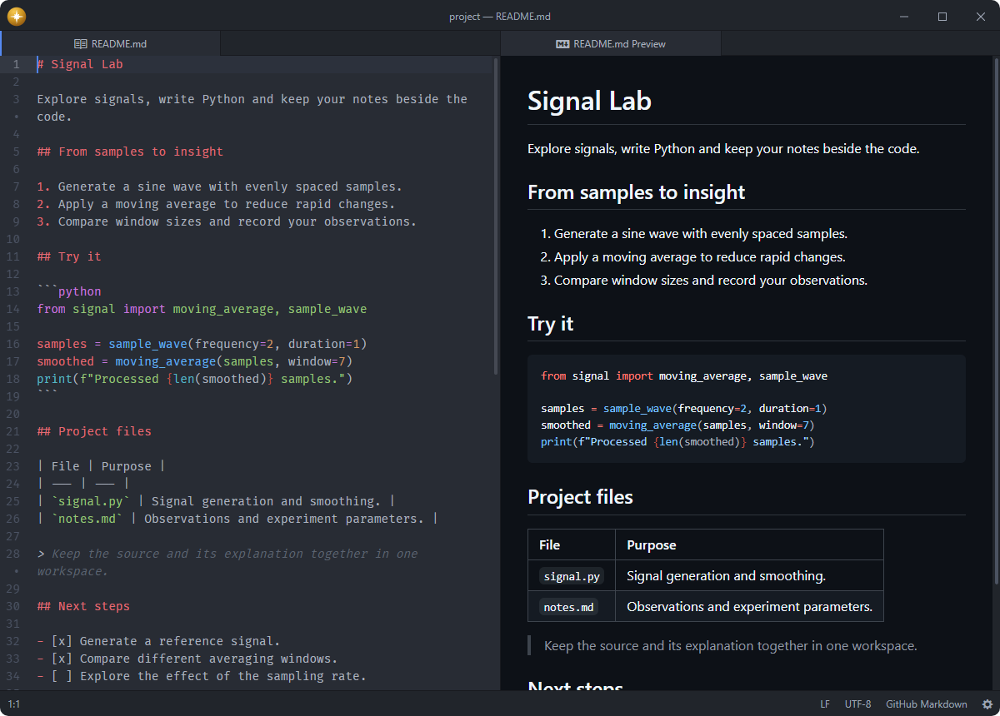
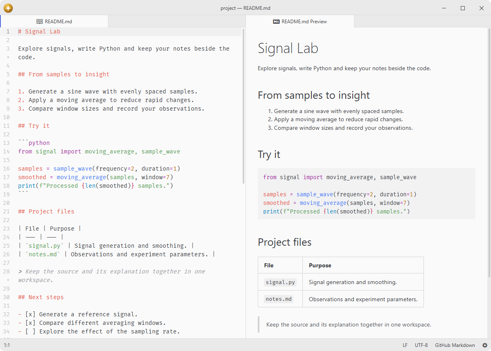
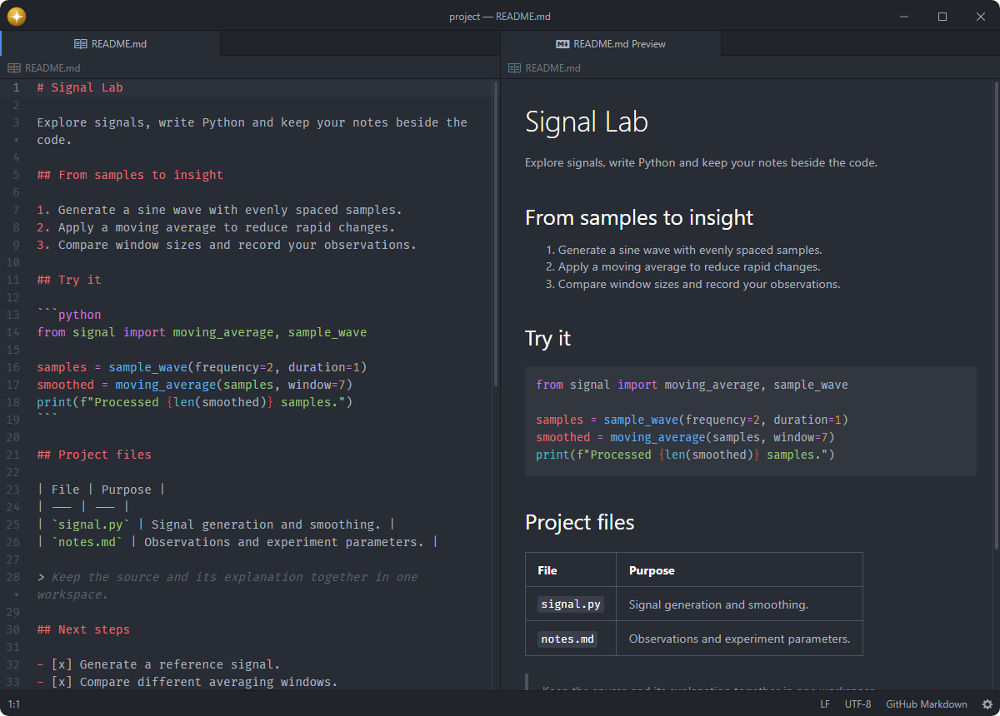

# markdown-preview

Open a live, rendered preview of the Markdown in the current editor.

Fork of [pulsar-edit/pulsar](https://github.com/pulsar-edit/pulsar) (`packages/markdown-preview`).

## Features

- **Live preview**: renders the active Markdown file and updates as you type.
- **Editor windows**: keeps selection, scrolling, styling and export dialogs local when a preview is detached.
- **Split pane**: opens the preview beside the source or in a new tab.
- **Tree view preview**: opens a preview straight from a Markdown file in the tree view.
- **HTML export**: copies the rendered HTML to the clipboard or saves it to a file.
- **PDF export**: prints the rendered preview to a PDF, without the surrounding editor.
- **GitHub styling**: renders with GitHub.com typography, colors and spacing by default, in light, dark, or system mode.
- **Syntax styling**: follows the active syntax palette when GitHub styling is disabled, independently of the UI theme.
- **Zoom controls**: zooms the preview in and out or resets it to the default level.









## Installation

To install `markdown-preview` search for it in the Install pane of the Lumine settings, or run the command `lumine --install lumine-code/markdown-preview`.

## Commands

Commands available in `lumine-text-editor:not([mini]):not(.markdown-preview lumine-text-editor)` and `.markdown-preview`:

- `markdown-preview:toggle`: open or close the preview for the current editor,
- `markdown-preview:save-as-html`: save the rendered HTML to a file,
- `markdown-preview:export-to-pdf`: export the rendered preview to a PDF file.

Commands available in `lumine-text-editor:not([mini])`:

- `markdown-preview:copy-html`: copy the rendered HTML to the clipboard.

Commands available in `lumine-workspace`:

- `markdown-preview:toggle-break-on-single-newline`: toggle line breaks on single newlines,
- `markdown-preview:toggle-github-style`: toggle the GitHub.com preview style.

Commands available in `.markdown-preview`:

- `markdown-preview:select-all`: select all of the rendered content,
- `markdown-preview:zoom-in`: zoom the preview in,
- `markdown-preview:zoom-out`: zoom the preview out,
- `markdown-preview:reset-zoom`: reset the preview zoom to the default level.

Use **Open…** in the tree view to choose Markdown Preview for a file.

## Usage

Click a file link such as `[Related document](related.md)` in the preview to open the existing file in the editor. Relative paths resolve from the Markdown document's directory. Inline and reference links support encoded filenames; URL queries and fragments are excluded from the target filename. Links beginning with `#` scroll within the preview.

Relative file links work with the default settings. Explicit `file://` URLs and absolute Windows paths require **Allow Unsafe Protocols**. Prefer relative links when sharing documentation.

## Customization

Adjust the preview's typography by adding CSS to your `styles.css`:

```css
.markdown-preview {
  font-size: 16px;
  max-width: 800px;
}
```

## Contributing

Got ideas to make this package better, found a bug, or want to help add new features? Just drop your thoughts on GitHub. Any feedback is welcome!
